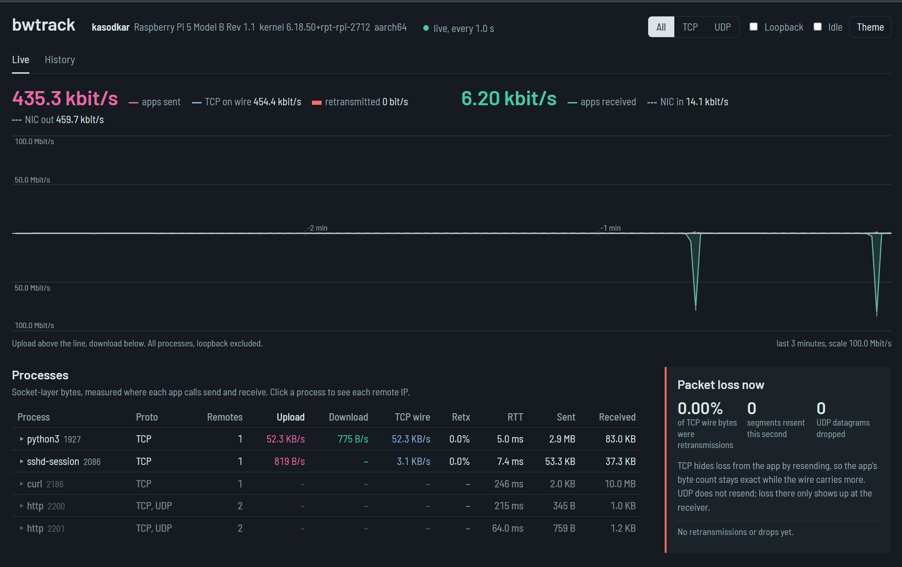
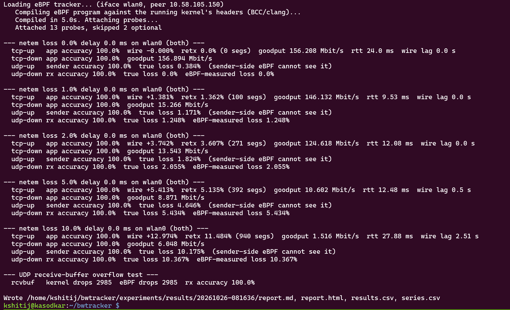
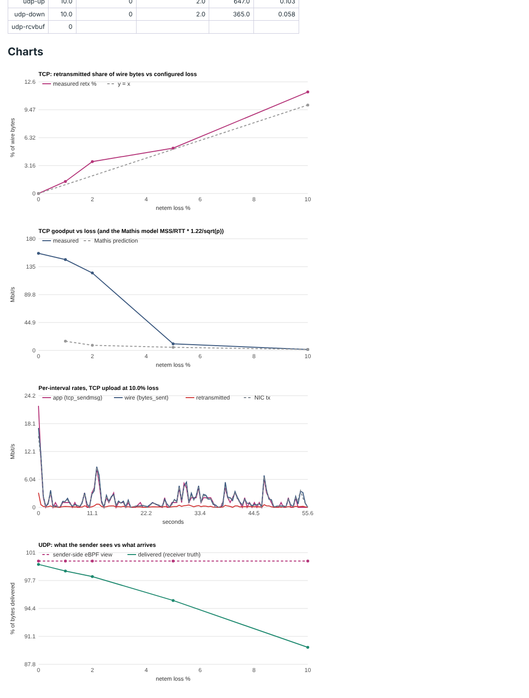
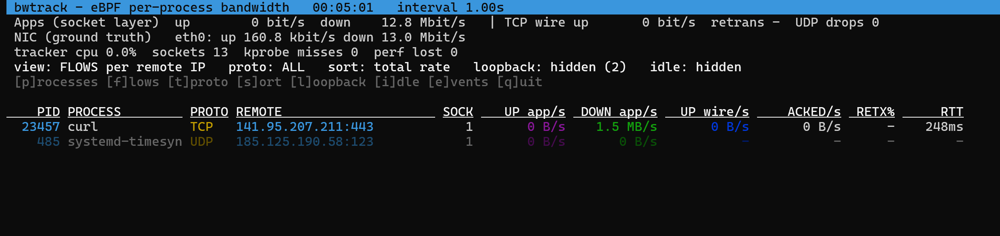

# bwtrack: per-process bandwidth tracker using eBPF

CS331 Computer Networks, team T001, project 4. Rebuilt from scratch.

bwtrack measures, **in real time and from inside the Linux kernel**, how many
bytes every process sends and receives, to which remote IP, over TCP or UDP.
For TCP it also reports what really went on the wire (including retransmissions),
the RTT and the congestion window. History is stored in SQLite, and a
Prometheus endpoint is included. There is no mock mode: every number comes
from eBPF probes on a real kernel.

```
sudo ./bwtrack live                 # terminal dashboard
sudo ./bwtrack web --port 8080      # web dashboard + JSON API + /metrics (+ history)
sudo ./bwtrack stream --view proc   # plain text, one table per second
sudo ./bwtrack events               # live TCP retransmissions / UDP drops
sudo ./bwtrack record               # headless, history only (systemd)
./bwtrack report --since 2h --by remote   # history reports (also --timeline, --csv)
sudo ./bwtrack doctor --compile     # checks kernel, headers, BCC and prints the fix
```

## Quick start

| where | setup |
|---|---|
| **Raspberry Pi 5** (target) | `sudo ./scripts/setup_pi.sh`, then see [docs/RASPBERRY_PI.md](docs/RASPBERRY_PI.md) |
| **WSL2** (development) | `sudo ./scripts/setup_wsl.sh` builds the missing kernel headers (fixes the `kheaders` error) |
| Ubuntu / Debian | `sudo apt install python3-bpfcc bpfcc-tools linux-headers-$(uname -r)` |

If the shell says `Permission denied` (files copied through Windows lose the
executable bit): `chmod +x bwtrack scripts/*.sh`.

Requirements: Linux ≥ 5.5 with kprobes, root, `python3-bpfcc` and the headers of
the running kernel. No pip packages: the user-space code uses only the Python
standard library.

## What is measured, and where

| layer | probe | gives |
|---|---|---|
| socket (per process) | kprobe+kretprobe `tcp_sendmsg`, kprobe `tcp_cleanup_rbuf` | TCP bytes each app sent / read |
| socket (per process) | kprobe+kretprobe `udp_sendmsg`, `udpv6_sendmsg`, kprobe `skb_consume_udp` | UDP bytes per remote IP (also unconnected `sendto`) |
| TCP engine | `struct tcp_sock` counters, refreshed from `tcp_rcv_established` | bytes on the wire incl. retransmissions, acked bytes, RTT, cwnd |
| TCP engine | tracepoint `tcp:tcp_retransmit_skb` | every retransmission, live, with the process |
| UDP receive | kretprobe `__udp_enqueue_schedule_skb` | datagrams dropped because the app is too slow |
| NIC | `/proc/net/dev` | ground truth including headers |

Why the layers disagree in real time (buffering, retransmissions, headers, UDP
loss being invisible to the sender, loopback double counting) is explained in
[docs/CONCEPTS.md](docs/CONCEPTS.md). That document also answers the TA review
points: loopback, kprobes, `tcp_sendmsg`/`udp_sendmsg`, and architecture.
The architecture is in [docs/ARCHITECTURE.md](docs/ARCHITECTURE.md).

## Accuracy and packet-loss experiments

```bash
# laptop:  python trafficgen.py server
sudo python3 experiments/run_experiments.py --peer <laptop-ip> --loss 0,1,2,5,10
```
See [experiments/README.md](experiments/README.md) for the method and sample
results.

## Proof suite (every claim tested)

```bash
sudo python3 experiments/proof_suite.py            # correctness, performance, scalability, 30-min soak
sudo bash experiments/run_final.sh <laptop-ip>     # proof suite + loss experiment x3 + 20 ms delay run
sudo python3 experiments/proof/overhead_check.py --peer <laptop-ip>   # with vs without tracker
```
Final Raspberry Pi 5 results: [experiments/pi_results/2026-10-30_final/](experiments/pi_results/2026-10-30_final/).

## Tests

```bash
python3 -m unittest discover -s tests -v       # aggregation, storage, Prometheus (no root)
sudo ./bwtrack doctor --compile                # kernel side: compiles and attaches all probes
```

## Layout

```
bwtrack                     launcher (adds sudo when needed)
bwtracker/bpf/tracker.bpf.c eBPF programs (kernel side)
bwtracker/*.py              collector, aggregation, TUI, web, storage, reports, doctor
bwtracker/web/index.html    web dashboard
tools/trafficgen.py         ground-truth traffic generator (runs on Windows too)
experiments/                loss experiments, proof suite, Pi results
scripts/                    setup_pi.sh, setup_wsl.sh, bwtrack.service
docs/                       CONCEPTS, ARCHITECTURE, RASPBERRY_PI, OLD_VS_NEW
tests/                      unit tests
```

## Screenshots (Raspberry Pi 5)

Live web dashboard on the Pi (`curl` download, `apt`, SSH and the dashboard itself):



Loss experiment running on the Pi:



Experiment charts (`experiments/pi_results/2026-10-26_pi5_wifi_loss/report.html`):



Terminal UI on WSL2 (flow view):


