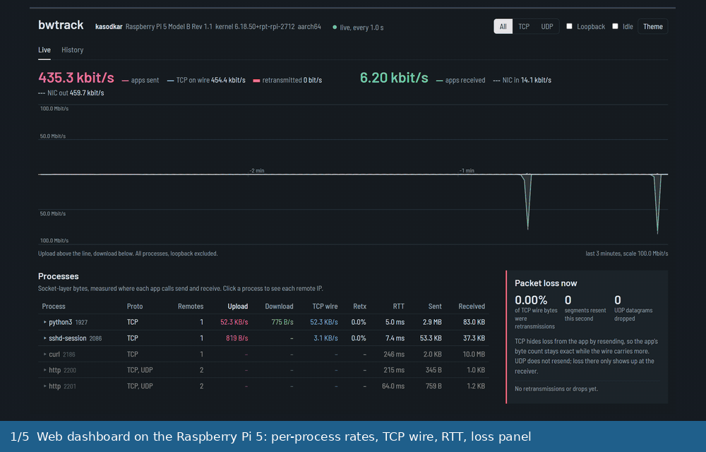
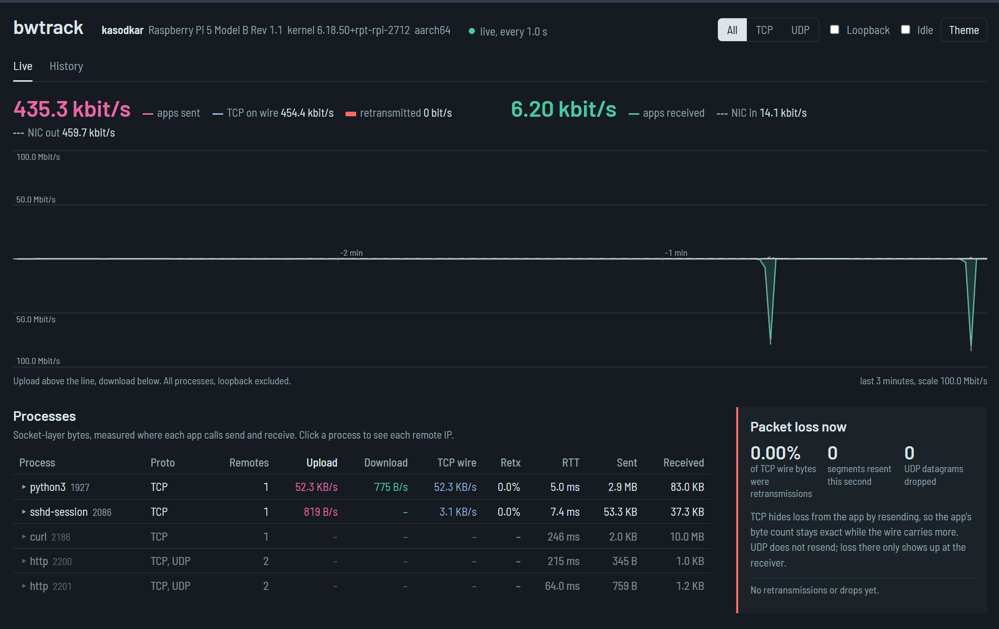
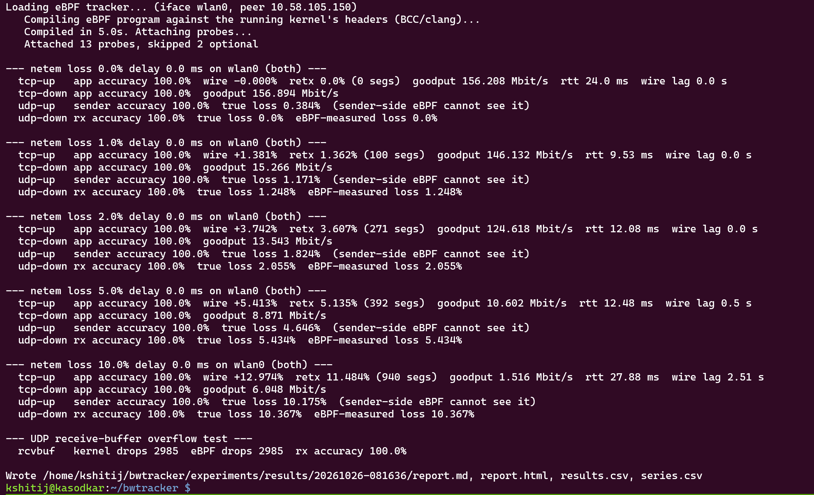
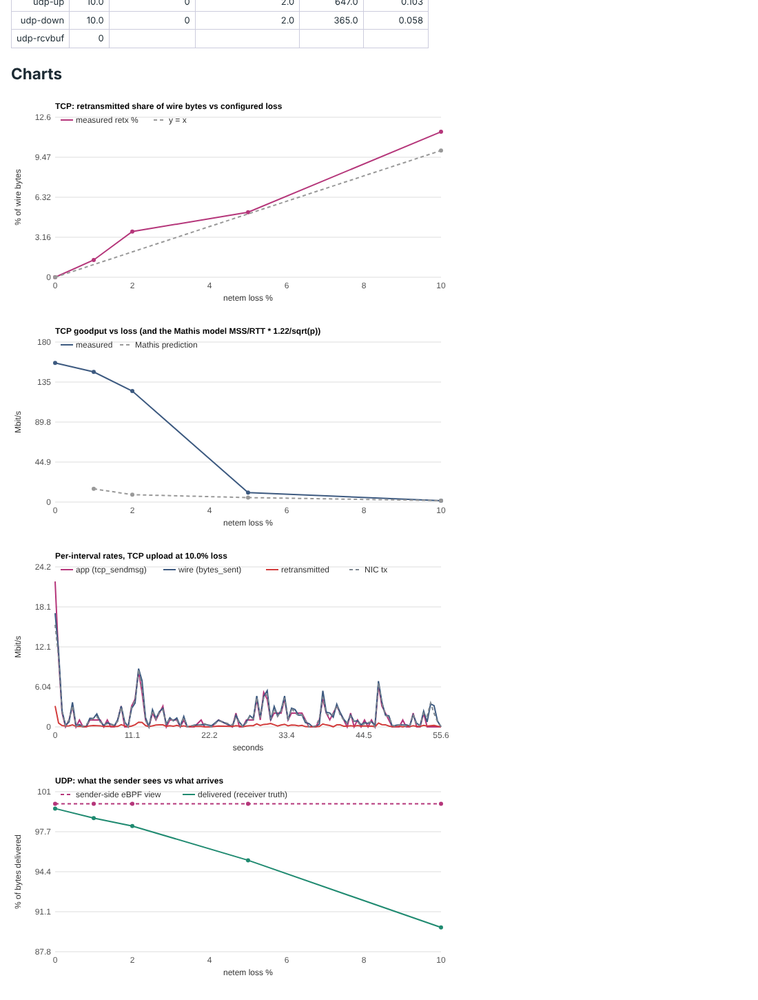
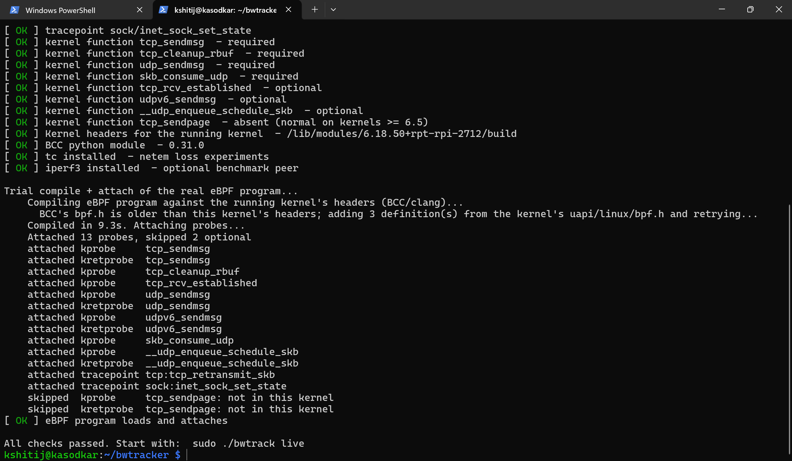
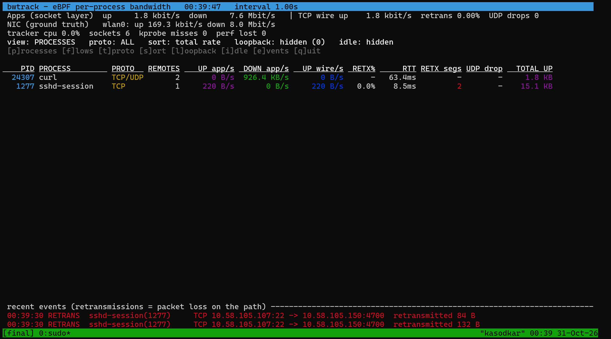
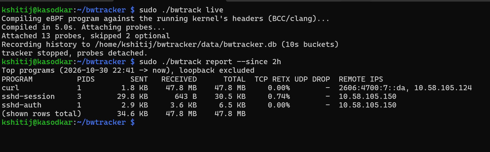
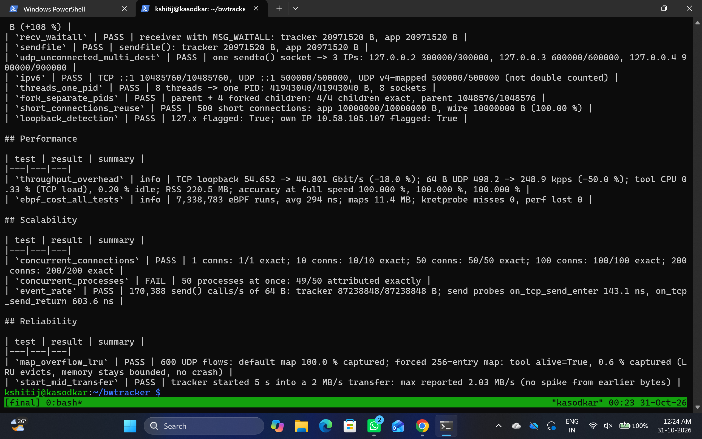
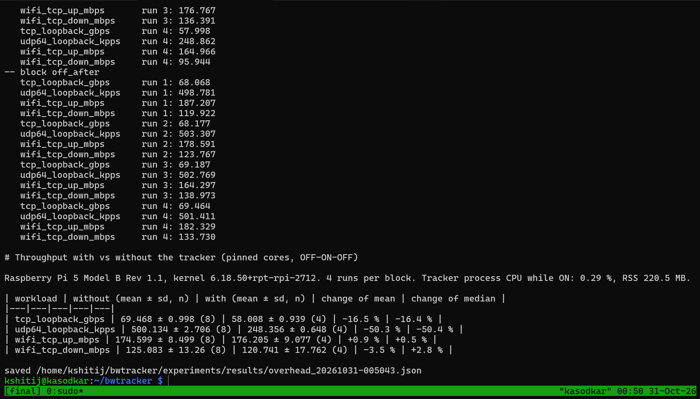
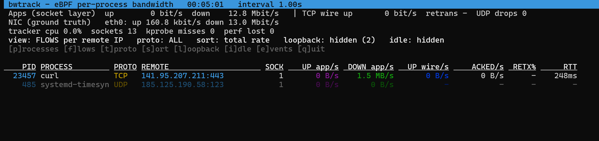

# 🚀 bwtrack: Real-Time Per-Process Bandwidth Tracker using eBPF

[](https://www.python.org/)
[](https://ebpf.io/)
[](https://www.raspberrypi.com/products/raspberry-pi-5/)
[](#-testbed)
[](Code/tests/test_logic.py)
[](#-how-it-works)
[](https://opensource.org/licenses/MIT)

<p align="center"></p>
<p align="center"><sub>Real screenshots from the Raspberry Pi 5 runs (30–31 Oct 2026). Full-size images are in <a href="#%EF%B8%8F-screenshots">Screenshots</a>.</sub></p>

**bwtrack** shows, **live and from inside the Linux kernel**, how much network bandwidth **every process** is using: per process, per remote IP and port, for **TCP and UDP**, upload and download. For TCP it also shows what really went **on the wire**: retransmissions, RTT and congestion window. That lets you **see packet loss as it happens** and explain why real-time numbers at different layers never agree exactly.

It runs on a **Raspberry Pi 5** (the main testbed), on Ubuntu, and on WSL2. It comes with a terminal dashboard, a web dashboard, SQLite history, a Prometheus endpoint and a reproducible **packet-loss experiment suite** (0–10 % loss) that checks every number against ground truth.

> 💻 **No Raspberry Pi needed for live tracking:** bwtrack also runs on Ubuntu and on WSL2 (see [Quickstart](#-quickstart)). Only the packet-loss experiments need the Pi, because they use `tc netem`, which the WSL2 kernel does not include.

> 🔁 **This is the final-evaluation version, rebuilt from scratch after the mid-semester review.** There is no mock mode: every number comes from real eBPF probes. See [What changed since the midsem](#-what-changed-since-the-midsem).

---

## 🎓 Course & Project Information

- **Course:** CS331: Computer Networks
- **Project Topic:** T001 (Topic 4): *Per-Process Bandwidth Tracker using eBPF*
- **Professor:** Sameer Kulkarni
- **Project TAs / Mentors:** Jainish, Shubham

### 👥 Team Members

| Roll Number | Name | Contact Email |
|:---:|---|---|
| **23110175** | Kshitij Kasodkar | `kshitij.kasodkar@iitgn.ac.in` |
| **23110126** | Hanamanthagouda Policepatil | `hanamanthagouda.p@iitgn.ac.in` |
| **22110140** | Manav Mangal Jain | `manav.jain@iitgn.ac.in` |
| **23110338** | Thipparapu Rushitha | `thipparapu.rushitha@iitgn.ac.in` |
| **24110278** | Ralebhat Priyanka Shriram | `priyanka.ralebhat@iitgn.ac.in` |

---

## 📚 Table of Contents

1. [Key Highlights](#-key-highlights)
2. [What changed since the midsem](#-what-changed-since-the-midsem)
3. [How it works](#-how-it-works)
4. [System Architecture](#%EF%B8%8F-system-architecture)
5. [Kernel Hooks](#-kernel-hooks-what-and-why)
6. [Metric Definitions: the three layers](#-metric-definitions-the-three-layers)
7. [Quickstart](#-quickstart)
8. [Usage](#%EF%B8%8F-usage)
9. [Packet-Loss Experiments & Results](#-packet-loss-experiments--results-raspberry-pi-5)
10. [Screenshots](#%EF%B8%8F-screenshots)
11. [Testbed](#-testbed)
12. [Repository Structure](#-repository-structure)
13. [Limitations & Future Work](#-limitations--future-work)
14. [Troubleshooting](#%EF%B8%8F-troubleshooting)
15. [Documentation](#-documentation)
16. [References](#-references)

---

## 🌟 Key Highlights

- 🎯 **Exact per-process attribution:** bytes are counted inside `tcp_sendmsg`, `udp_sendmsg` and the receive paths, which run *in the context of the process that moves the data*, so the PID is always correct.
- 🌐 **Per remote endpoint:** remote IP and port for every flow, including unconnected UDP (`sendto()`, e.g. DNS), IPv4 and IPv6.
- 📡 **TCP wire view:** bytes really transmitted (including retransmissions), bytes acknowledged, smoothed RTT, congestion window and TCP state, read from the kernel's own `struct tcp_sock` counters.
- 🔴 **Live packet-loss detection:** every TCP retransmission (tracepoint `tcp:tcp_retransmit_skb`) and every UDP receive-buffer drop is shown as an event, with the process that caused it.
- 🧮 **Three measurement layers side by side:** app/socket, TCP wire and network card (NIC), so the gaps caused by buffering, retransmissions and headers are visible instead of hidden.
- 🔁 **Loopback-aware:** traffic to `127.0.0.1` or the machine's own IPs is detected and hidden by default, because it would be counted twice and is not network traffic.
- ⚡ **Low overhead, measured:** counters are aggregated **inside the kernel** in LRU BPF maps and read once per second. On a Pi 5 the real Wi-Fi throughput with the tracker running is unchanged (**174.6 → 176.2 Mbit/s**), probes cost **294 ns** per run on average, and the tracker process uses **0.29 % CPU**.
- ✅ **Every claim has a test:** a proof suite (`experiments/proof_suite.py`) compares the tracker with byte counts printed by the workload itself: correctness, overhead, scalability (200 connections), 30-min soak. It found two bugs in our own tracker, which are now fixed.
- 📊 **Four interfaces:** curses terminal UI, web dashboard (live chart + history), SQLite history with CSV reports, and Prometheus `/metrics` for Grafana.
- 🧪 **Reproducible accuracy experiments:** `tc netem` loss in both directions on a real Wi-Fi link, compared against byte counts and UDP sequence numbers at both ends.
- 🩺 **Self-diagnosing and self-healing:** `bwtrack doctor` checks the kernel, headers and BCC and prints the exact fix. The loader automatically patches the BCC/kernel-header mismatch that breaks compilation on new kernels such as the Pi's 6.18.
- 📦 **Zero pip dependencies:** Python standard library + the distro's `python3-bpfcc`. Works on Raspberry Pi OS, where system-wide `pip` is blocked.

---

## 🔁 What changed since the midsem

| # | Midsem version | Problem (review feedback) | Final version |
|:-:|---|---|---|
| 1 | Only the **mock** mode ran; the real mode failed with `kheaders not found` on WSL2 | “Not real-time, just printing” | **No mock.** `setup_wsl.sh` builds the WSL2 headers; `setup_pi.sh` sets up the Pi; every number comes from kernel probes |
| 2 | Mock generated random numbers for `chrome`, `steam`, `discord`… | On WSL2 those are **Windows** apps, invisible to Linux eBPF | Real processes only; WSL2 limitation documented |
| 3 | “100 % accuracy” measured over **loopback** | Loopback never loses packets: the test proved nothing. “Accuracy should not be 100 % in real time, especially TCP” | Real Wi-Fi link + `netem` loss; **three layers** compared against ground truth; real-time error quantified |
| 4 | Counted the requested `size` of `tcp_sendmsg` | Over-counts partial / failed sends | kprobe **+ kretprobe**: counts bytes actually accepted |
| 5 | Counted `copied` in `tcp_cleanup_rbuf` | Double counts with `MSG_WAITALL` | Counts the advance of `tp->copied_seq` |
| 6 | No UDP receive hook, IPv4 only, UDP remote = `0.0.0.0` | UDP download was always 0; DNS unattributed | `skb_consume_udp`, `udpv6_sendmsg`, destination from `msg_name`, IPv4 + IPv6 |
| 7 | One perf event per send | High CPU; lost events = lost bytes | In-kernel aggregation in maps, read once per second |
| 8 | No retransmission / loss information | Professor: show packet loss, use a Raspberry Pi | Wire bytes, retransmissions, RTT, UDP drops; validated on a **Raspberry Pi 5** |
| 9 | FastAPI / Rich via pip | `pip` blocked on Raspberry Pi OS (PEP 668) | Python standard library only |
| 10 | Performance and accuracy numbers without tests | Final review: every number must be backed by proof | `proof_suite.py`, `run_final.sh`, `overhead_check.py`: every number in the PPT/report links to a result file in [`Code/experiments/pi_results/2026-10-30_final/`](Code/experiments/pi_results/2026-10-30_final/) |

---

## 💡 How it works

1. **eBPF programs** (`Code/bwtracker/bpf/tracker.bpf.c`) are compiled by **BCC** at start-up against the running kernel's headers, checked by the kernel **verifier**, JIT-compiled, and attached to kernel functions with **kprobes/kretprobes** and **tracepoints**.
2. When an application sends or receives data, the kernel runs our program **in that application's context**. It reads the socket (addresses, ports) and the byte count, and adds them atomically to a **BPF map** keyed by *(socket, PID, protocol, local/remote address and port)*.
3. The same programs copy TCP's own counters (`bytes_sent`, `bytes_retrans`, `bytes_acked`, `srtt_us`, `snd_cwnd`) per socket, and stream rare events (retransmissions, UDP drops) through a perf buffer.
4. Every second, the **Python collector** reads the maps, turns cumulative counters into per-interval deltas and rates, groups them per process and remote IP, adds NIC counters from `/proc/net/dev`, and hands one **Snapshot** to every interface (terminal, web, SQLite, Prometheus).

---

## 🗺️ System Architecture

```text
  APPLICATIONS (curl, browser, apt, python ...)                 user space
        |  send() / recv() system calls
        v
+----------------------------- LINUX KERNEL --------------------------------+
|                                                                           |
|  SOCKET LAYER  (process context: "current" = the application)             |
|    tcp_sendmsg    <- kprobe + kretprobe   tcp_cleanup_rbuf <- kprobe      |
|    udp_sendmsg    <- kprobe + kretprobe   skb_consume_udp  <- kprobe      |
|    udpv6_sendmsg  <- kprobe + kretprobe                                   |
|            |  eBPF programs update maps          |                        |
|            v                                     v                        |
|   +------------------------- BPF MAPS ------------------------------+     |
|   | flows      (sk, pid, proto, addrs, ports) -> tx/rx bytes, comm  |     |
|   | tcp_snaps  sk -> bytes_sent/retrans/acked, RTT, cwnd            |     |
|   | sk_owner   sk -> pid, comm        udp_drops  sk -> count        |     |
|   | events     perf buffer -> retransmissions, UDP drops            |     |
|   +-----------------------------------------------------------------+     |
|            ^                                     ^                        |
|  TCP ENGINE / RECEIVE PATH  (softirq: "current" is unreliable)            |
|    tcp_rcv_established         <- kprobe (refresh TCP snapshot)           |
|    tcp:tcp_retransmit_skb      <- tracepoint (every retransmission)       |
|    sock:inet_sock_set_state    <- tracepoint (open / close)               |
|    __udp_enqueue_schedule_skb  <- kretprobe (receive buffer full)         |
|                                                                           |
|  IP -> qdisc (netem) -> driver -> NIC          /proc/net/dev counters     |
+---------------------------------------------------------------------------+
        ^  bpf() syscall: read maps once per second, poll perf buffer
        |
+----------------------- USER SPACE (Python 3, bwtracker/) -----------------+
|  collector.KernelProbes -> collector.Aggregator -> Snapshot every 1 s     |
|  runner.Hub (background thread) hands each Snapshot to:                   |
|    tui.py (curses)   webui.py + web/index.html   storage.py (SQLite)      |
|    prometheus.py (/metrics)          report.py reads the SQLite history   |
+---------------------------------------------------------------------------+
```

### 🧠 Key design decisions

| Decision | Instead of | Why |
|---|---|---|
| Hook the **socket layer** | packet layer (XDP, TC, libpcap) | Only there does the kernel run in the owning process's context: exact PID. Packets carry no process. |
| **kprobe + kretprobe** pair | counting the `size` argument | The return value = bytes really accepted. |
| **Counters in BPF maps**, read every 1 s | one perf event per send | Constant cost, nothing lost if user space is slow. |
| **LRU hash** maps | plain hash maps | Bounded memory; a full map never blocks new flows. |
| Read **TCP's own counters** | counting segments in transmit functions | Exact retransmission/wire numbers maintained by TCP itself. |
| **BCC** (runtime compile) | libbpf + CO-RE | Raspberry Pi OS kernels ship **without BTF**; BCC only needs headers. |
| **Python standard library** | Flask / FastAPI / Rich | Pi OS blocks system `pip`; a venv cannot import `python3-bpfcc`. |
| **SQLite** (10 s buckets) | InfluxDB / per-packet logs | Zero setup, small on an SD card; Prometheus covers time-series use. |

---

## 🔌 Kernel Hooks (what and why)

| Hook | Type | Gives | Detail |
|---|---|---|---|
| `tcp_sendmsg` | kprobe + kretprobe | TCP bytes sent by the app | Counts the **return value**; also covers `sendfile()` since Linux 6.5 (`tcp_sendpage` hooked on older kernels) |
| `tcp_cleanup_rbuf` | kprobe | TCP bytes read by the app | Advance of `tp->copied_seq` → no double counting |
| `udp_sendmsg` / `udpv6_sendmsg` | kprobe + kretprobe | UDP bytes sent | Destination from `msg->msg_name`; v6→v4 nesting counted once |
| `skb_consume_udp` | kprobe | UDP bytes received | IPv4 + IPv6; sender address from the packet headers |
| `tcp_rcv_established` | kprobe | Fresh wire statistics | Softirq; refresh only (≤ every 100 ms per socket) |
| `tcp:tcp_retransmit_skb` | tracepoint | Every retransmission | Counter + live event with the owning process |
| `sock:inet_sock_set_state` | tracepoint | Connection open/close | Final snapshot; resets state when a socket address is reused |
| `__udp_enqueue_schedule_skb` | kprobe + kretprobe | UDP receive-buffer drops | Negative return = buffer full = datagram dropped |

---

## ⚡ Metric Definitions: the three layers

| Layer | Metric | Source | Includes | Per process |
|---|---|---|---|:-:|
| **App / socket** | `UP app/s`, `DOWN app/s`, totals | our kprobes | exactly what the app sent / read | ✅ |
| **TCP wire** | `UP wire/s`, `ACKED/s`, `RETX %`, `RETX segs`, `RTT`, `CWND` | `struct tcp_sock` (RFC 4898 counters) | + retransmissions; timing set by TCP, not the app | ✅ |
| **NIC** | `NIC in/out` | `/proc/net/dev` | + all headers, ACKs and every other packet on the interface | ❌ |

- **Rate** = (counter now − counter one interval ago) ÷ interval, using a monotonic clock.
- **RETX %** = retransmitted bytes ÷ wire bytes in the interval.
- **UDP drop** = datagrams dropped because the receiving socket's buffer was full.

> 💬 **Why the layers never agree second by second:** `send()` returns when data is in the kernel's send buffer, not when it is transmitted. TCP then sends at its own pace and resends lost segments, and every packet carries headers. Over a whole transfer the app layer is exact; in real time no single layer is. bwtrack shows all three.

---

## 🚀 Quickstart

### 1. Requirements
- Linux kernel ≥ 5.5 with kprobes (Raspberry Pi OS, Ubuntu 22.04/24.04, WSL2 all work)
- Root (`sudo`), `python3-bpfcc` and the headers of the **running** kernel

### 2. Raspberry Pi 5 (recommended testbed) 🍓
Flash **Raspberry Pi OS Lite (64-bit)** with Raspberry Pi Imager (enable SSH and Wi-Fi), then:
```bash
scp -r Code <user>@<pi-name>.local:~/bwtracker        # from your laptop
ssh <user>@<pi-name>.local
cd ~/bwtracker && chmod +x bwtrack scripts/*.sh
sudo ./scripts/setup_pi.sh       # BCC + linux-headers-rpi-2712 + tc + iperf3, then doctor
```
Full beginner guide: [`Code/docs/RASPBERRY_PI.md`](Code/docs/RASPBERRY_PI.md)

### 3. WSL2 (Windows) 🪟
```bash
cp -r Code ~/bwtracker && cd ~/bwtracker     # run from the Linux file system, not /mnt/c
chmod +x bwtrack scripts/*.sh
sudo ./scripts/setup_wsl.sh      # builds headers for the WSL2 kernel (~5–15 min, once)
```
> ⚠️ WSL2 only sees Linux processes inside WSL (not Windows apps) and its kernel has no `netem`, so loss experiments need the Pi.

### 4. Ubuntu / Debian 🐧
```bash
sudo apt install -y python3-bpfcc bpfcc-tools linux-headers-$(uname -r) iproute2 iperf3
cd Code && chmod +x bwtrack && sudo ./bwtrack doctor --compile
```

### 5. Check everything ✅
```bash
sudo ./bwtrack doctor --compile
```
```text
[ OK ] CONFIG_KPROBES=y  - kprobes
[ OK ] Kernel headers for the running kernel  - /lib/modules/6.18.50+rpt-rpi-2712/build
[ OK ] BCC python module  - 0.31.0
...
    Compiling eBPF program against the running kernel's headers (BCC/clang)...
      BCC's bpf.h is older than this kernel's headers; adding 3 definition(s) ... retrying...
    Compiled in 8.2s. Attaching probes...
    Attached 13 probes, skipped 2 optional
[ OK ] eBPF program loads and attaches
All checks passed. Start with:  sudo ./bwtrack live
```

---

## 🖥️ Usage

### 📊 Live terminal dashboard
```bash
sudo ./bwtrack live
```
| Key | Action | Key | Action |
|:-:|---|:-:|---|
| `p` | processes view | `f` | flows per remote IP (RTT, CWND, state) |
| `t` | protocol: ALL → TCP → UDP | `s` | sort: rate, up, down, bytes, retrans, pid |
| `l` | show/hide loopback | `i` | show/hide idle rows |
| `e` | show/hide event log | `q` | quit |

### 🌐 Web dashboard + Prometheus
```bash
sudo ./bwtrack web --port 8080
```
Open **http://localhost:8080** (or `http://<pi-name>.local:8080` from your laptop). The **Live** tab shows a chart with upload above the axis and download below (app, wire, retransmitted and NIC traces), a per-process table you can expand per remote IP, and a packet-loss panel with live events. The **History** tab shows totals per program, remote IP, protocol or port, with CSV download. `/metrics` serves Prometheus format.

### 🧾 Other modes
```bash
sudo ./bwtrack stream --view proc     # plain-text table every second (logs, screenshots)
sudo ./bwtrack events                 # only TCP retransmissions and UDP drops, live
sudo ./bwtrack record                 # headless history recorder (see scripts/bwtrack.service)
```

### 📜 History & reports
```bash
sudo ./bwtrack report --since 24h                    # top programs
sudo ./bwtrack report --by remote                    # top remote IPs (+ which programs)
sudo ./bwtrack report --by process-remote --proto tcp
sudo ./bwtrack report --timeline --bucket 60         # traffic per minute with text bars
sudo ./bwtrack report --by remote --csv usage.csv    # export
```

### 🧪 Tests
```bash
python3 -m unittest discover -s tests -v    # 14 unit tests, no root needed
```

---

## 🔬 Packet-Loss Experiments & Results (Raspberry Pi 5)

All results below come from one run on **30–31 Oct 2026** ([raw files and index](Code/experiments/pi_results/2026-10-30_final/)).

### Method
```text
 Raspberry Pi 5 (kasodkar)                              Laptop (Windows)
+------------------------------------------+         +--------------------------+
| run_experiments.py: loads eBPF tracker   |  Wi-Fi  | trafficgen.py server     |
| trafficgen client -> kernel -> netem ->  |-------->| (Windows Python)         |
|   (counts sent)    (probes)   (tc) wlan0 |<--------| counts bytes received    |
|                                          | hotspot | and UDP sequence numbers |
+------------------------------------------+         +--------------------------+
```
- `tc netem` drops 0, 1, 2, 5, 10 % of packets **in both directions** (IFB device for ingress). Repeated **3 times**, plus one run with **+20 ms delay** each way.
- Per level: TCP upload and download of 20 MiB, UDP upload and download at 20 Mbit/s for 5 s, plus a UDP receive-buffer overflow test.
- **Ground truth:** byte counts of the traffic generator at both ends and per-datagram **sequence numbers** (independent of eBPF).

```bash
# laptop (PowerShell)
py trafficgen.py server --port 5300
# Raspberry Pi: proof suite + loss x3 + delay run, ~70 min, writes ~/final_results.zip
sudo bash experiments/run_final.sh <laptop-ip>
```

### 📈 TCP upload: app layer vs wire (mean ± sd, 3 runs)
| netem loss | app accuracy | wire bytes vs app | retransmitted (% of wire) | retx segments | goodput | wire lag |
|:-:|:-:|:-:|:-:|:-:|:-:|:-:|
| 0 % | **100.0 %** | +0.89 ± 1.54 % | 0.86 % | 128 | 178 ± 15 Mbit/s | 0.2 s |
| 1 % | **100.0 %** | +1.24 ± 0.76 % | 1.22 % | 179 | 156 ± 29 Mbit/s | 0.2 s |
| 2 % | **100.0 %** | +1.72 ± 0.32 % | 1.69 % | 250 | 132 ± 36 Mbit/s | 0.3 s |
| 5 % | **100.0 %** | +6.30 ± 0.45 % | 5.92 % | 912 | 12.5 ± 3.2 Mbit/s | 1.5 s |
| 10 % (n = 2) | **100.0 %** | +12.07 ± 0.05 % | 10.77 % | 1749 | 1.5 ± 0.5 Mbit/s | 9–27 s |

At 0 % loss the wire equals the app exactly when Wi-Fi itself loses nothing (+0.000 % in runs 2 and 3; run 1 had 274 real Wi-Fi retransmissions).

### 📉 UDP: the sender cannot see loss (mean of 3 runs)
| netem loss | Upload: sender's eBPF view | Upload: true loss | Download: true loss | Download: eBPF-measured loss |
|:-:|:-:|:-:|:-:|:-:|
| 0 % | 100 % sent | 0.05 % | 0.22 % | **0.22 %** |
| 1 % | 100 % sent | 0.99 % | 1.04 % | **1.04 %** |
| 2 % | 100 % sent | 2.06 % | 2.07 % | **2.07 %** |
| 5 % | 100 % sent | 5.23 % | 5.10 % | **5.10 %** |
| 10 % | 100 % sent | 9.69 % | 10.15 % | **10.15 %** |

**UDP receive-buffer overflow:** kernel `RcvbufErrors` = **2985**, eBPF drops = **2985**.

### 🧩 What the results show
1. ✅ **Totals are exact at the app layer:** in all **59** completed loss trials the socket-layer bytes equal what the application sent or received.
2. 📦 **The wire carries more, in proportion to loss:** +12.1 % at 10 % loss (1749 resent segments).
3. ⏱️ **Real time is not 100 % accurate:** per 0.5 s sample, app and wire bytes differ by **29–90 %** on average. At 10 % loss the app had finished **9–27 s** before TCP delivered everything.
4. 🙈 **UDP loss is invisible to the sender:** only the receiver sees it, and there eBPF matches the truth in all 15 trials.
5. 🐢 **Delay multiplies the damage:** with +20 ms each way, 1 % loss cuts upload from 156 to **3.7 Mbit/s**. The Mathis model with the RTT *our tool measured* predicts 2.8 / 2.0 / 1.1 / 0.57 Mbit/s at 1 / 2 / 5 / 10 %; we measured 3.7 / 2.5 / 1.4 / 0.46.

---

## ✅ Proof suite: correctness, performance, scalability, reliability

`sudo python3 experiments/proof_suite.py`: each test runs a workload that prints its own PID and exact byte counts, and compares them with the tracker ([test list](Code/experiments/README.md#proof-suite-correctness-performance-scalability-reliability)).

| Group | Result on the Pi |
|---|---|
| **Correctness** (9/9 pass) | partial non-blocking sends exact (counting the requested size would be +108 %) · `MSG_WAITALL` · `sendfile()` · unconnected UDP to 3 IPs · IPv6 + v4-mapped UDP · 8 threads → 1 PID · `fork()` children get their own PID · **500 short connections: app and wire 10,000,000 B exact** · own LAN IP marked local |
| **Performance** | OFF-ON-OFF, pinned cores, 4 runs each: **Wi-Fi upload 174.6 → 176.2 Mbit/s, download 125.1 → 120.7 (within noise)**; stress only: loopback TCP 69.5 → 58.0 Gbit/s (−16.5 %), 64-byte UDP flood 500 → 248 k pkt/s (−50 %). eBPF 294 ns/run avg over 7.3 M runs · tracker 0.29 % CPU · maps 11.4 MB · RSS 220 MB (BCC/LLVM) |
| **Scalability** | 1 / 10 / 50 / 100 / 200 simultaneous connections all exact (collector CPU 4.0 → 12.4 %) · 170,388 `send()` calls/s exact · 50 processes at once: 49/50 once, then 250/250 in 5 repeats |
| **Reliability** | 30-min soak of `bwtrack record`: **2,511 / 2,511** short-lived processes exact in SQLite; RSS 220.3 → 223.3 MB; CPU 1.9 % · 0 kretprobe misses, 0 lost events · map overfilled: LRU evicts, no crash · started mid-transfer: no false spike |

**Bugs the suite found (fixed):** short connections reported 0 wire bytes, and the first chunk of every connection was missing from the wire count. Fix: zero baseline at SYN, final counters added to the flow at close. Also, the peer's FIN was counted as 1 byte of data.

---

## 🖼️ Screenshots

**Web dashboard on the Raspberry Pi 5:** a `curl` download, `apt update` (http helpers), SSH, and the dashboard itself serving the laptop over Wi-Fi.


**Loss experiment on the Pi** (0–10 % netem loss, compared with ground truth):


**Experiment charts** (retransmitted share vs loss, goodput vs Mathis model, per-sample rates at 10 % loss, UDP sender view vs delivered):


**`doctor` on the Pi**: automatic BCC/kernel-6.18 compatibility fix, 13 probes attached:


**Live terminal view on the Pi** during a 50 MB download: `curl` at 926 KB/s, NIC 8.0 Mbit/s, and two real Wi-Fi retransmissions on the SSH session in the events panel:


**History report** from SQLite (IPv6 to Cloudflare, DNS via the hotspot):


**Proof suite on the Pi** and **overhead check** (OFF-ON-OFF):



**Terminal UI (flow view) on WSL2**: per remote IP, with RTT to a server in France (246 ms) and DNS lookups attributed to `curl` and `wget`:


---

## 🧰 Testbed

| Component | Details |
|---|---|
| Main device | **Raspberry Pi 5 Model B**, 8 GB RAM, 64 GB microSD |
| OS / kernel | Raspberry Pi OS Lite 64-bit (Debian 13 “Trixie”), kernel **6.18.50+rpt-rpi-2712**, aarch64 |
| eBPF toolchain | BCC **0.31.0** (`python3-bpfcc`), `linux-headers-rpi-2712` |
| Network | Wi-Fi (`wlan0`) via a OnePlus 11 5G phone hotspot |
| Peer | Windows 11 laptop, Python 3.13, `trafficgen.py server` |
| Final run | 30–31 Oct 2026, Pi `10.58.105.107` ↔ laptop `10.58.105.150` on the same hotspot |
| Also tested | WSL2 kernel 5.15.167.4 (BCC 0.29.1), Ubuntu 24.04 kernel 6.8 and 22.04 kernel 5.15 (BCC 0.18) in QEMU (proof suite correctness + scalability pass on both) |

---

## 📂 Repository Structure

```text
CS331_T001_PerProcess_eBPF_Final/
├── README.md                     # This file
├── LICENSE                       # MIT License
├── Report.pdf                    # Final project report (IEEE-style template)
├── PPT.pdf                       # ⭐ Final presentation (instructor's 5-slide format + proof slides)
├── AI_Used/                      # 🤖 Raw AI conversations (no summaries)
│   ├── README.md                 # Which tool, which period, how the log was exported
│   ├── Claude_conversation_2026-10-26_to_2026-11-04.md   # final phase, every prompt and reply
│   └── midsem/                   # Mid-semester phase (Google Antigravity / Gemini)
└── Code/
    ├── bwtrack                   # Launcher (adds sudo when needed)
    ├── README.md                 # Code-level guide
    ├── bwtracker/
    │   ├── bpf/tracker.bpf.c     # ⚙️ Kernel side: all eBPF programs and maps
    │   ├── collector.py          # Load/attach probes, read maps, deltas → rates
    │   ├── compat.py             # Self-healing compile for new kernels (Pi 6.18)
    │   ├── model.py              # Data classes and filtering
    │   ├── netutil.py            # Addresses, loopback detection, /proc readers
    │   ├── runner.py             # Collector thread, fan-out to interfaces
    │   ├── tui.py, views.py      # Terminal dashboard
    │   ├── webui.py, web/        # Web dashboard + JSON API + /metrics
    │   ├── storage.py, report.py # SQLite history and reports
    │   ├── prometheus.py         # Prometheus exposition
    │   ├── doctor.py             # Environment checks with fixes
    │   └── __main__.py           # CLI: live, web, stream, events, record, report, doctor
    ├── tools/trafficgen.py       # Ground-truth traffic generator (Linux + Windows)
    ├── experiments/
    │   ├── run_experiments.py    # netem loss experiments → report.html/md/csv
    │   ├── proof_suite.py        # ✅ correctness / performance / scalability / reliability tests
    │   ├── proof/                # workload processes + overhead_check.py + diag_processes.py
    │   ├── run_final.sh          # one command: proof suite + loss ×3 + delay run
    │   ├── combine_runs.py       # mean ± sd over repeated runs
    │   ├── pi_results/           # ✅ Raspberry Pi 5 results: 2026-10-30_final (used in PPT/report), 2026-10-26 first run
    │   └── sample_results/       # Development-VM runs (kernels 5.15 and 6.8)
    ├── scripts/                  # setup_pi.sh, setup_wsl.sh, bwtrack.service
    ├── tests/test_logic.py       # 14 unit tests
    └── docs/
        ├── CONCEPTS.md           # Fundamentals: kprobes, loopback, tcp_sendmsg/udp_sendmsg
        ├── ARCHITECTURE.md       # Design and data flow
        ├── RASPBERRY_PI.md       # Step-by-step Pi guide
        ├── OLD_VS_NEW.md         # Midsem vs final
        └── img/                  # Screenshots
```

---

## 🚧 Limitations & Future Work

| Limitation | Possible improvement |
|---|---|
| Per-process numbers are payload bytes (no headers) | estimate headers per segment, or eBPF `cgroup_skb` |
| ICMP (ping), raw sockets and kernel traffic are not attributed | hook `sock_sendmsg` / tracepoint `sock:sock_send_length` (Linux ≥ 6.3) |
| Container processes appear with host PIDs | add cgroup id / network-namespace cookie to the key |
| kprobes depend on internal function names | `fentry`/`fexit` + CO-RE once the kernel ships BTF |
| BCC needs headers + LLVM on the device (5–9 s start, 220 MB RSS) | libbpf + CO-RE |
| Probe cost visible for floods of tiny packets (−50 % at 500 k packets/s on loopback) | fentry/fexit (cheaper than kprobes), skip the entry probe for UDP when connected |
| TLS traffic counted as encrypted bytes | uprobes on OpenSSL for plaintext sizes |

---

## 🛠️ Troubleshooting

| Symptom | Fix |
|---|---|
| `Unable to find kernel headers` / `kheaders not found` | Pi: `sudo ./scripts/setup_pi.sh` (reboot if the kernel was just upgraded). WSL2: `sudo ./scripts/setup_wsl.sh` |
| `incomplete type 'struct bpf_task_work'` | Use the final code: `compat.py` fixes it automatically |
| `Permission denied` on `./bwtrack` | `chmod +x bwtrack scripts/*.sh` |
| `rm: Permission denied` when updating the folder | files created by `sudo` runs: `sudo rm -rf ~/bwtracker` |
| `ping` traffic not shown | expected: ICMP does not use TCP/UDP sockets |
| Windows apps not shown on WSL2 | expected: WSL2 is a separate Linux VM |
| `kasodkar.local` not found from WSL | use the IP, or `ping.exe -4 -n 1 <name>.local` |
| Experiment fails at 1 % on WSL2 | WSL2 kernel has no `netem`; run experiments on the Pi |

---

## 📖 Documentation

- 🧠 [`Code/docs/CONCEPTS.md`](Code/docs/CONCEPTS.md): kprobes, kretprobes, tracepoints, loopback, `tcp_sendmsg`/`udp_sendmsg`, why real-time accuracy is not 100 %
- 🏗️ [`Code/docs/ARCHITECTURE.md`](Code/docs/ARCHITECTURE.md): design decisions and data flow
- 🍓 [`Code/docs/RASPBERRY_PI.md`](Code/docs/RASPBERRY_PI.md): Pi setup, live tracking, experiments
- 🔁 [`Code/docs/OLD_VS_NEW.md`](Code/docs/OLD_VS_NEW.md): what changed since the midsem
- 🧪 [`Code/experiments/README.md`](Code/experiments/README.md): experiment method and metrics
- 📄 [`Report.pdf`](Report.pdf): final report
- 🎤 [`PPT.pdf`](PPT.pdf): final presentation; every slide names its evidence file
- 📁 [`Code/experiments/pi_results/2026-10-30_final/`](Code/experiments/pi_results/2026-10-30_final/): all raw results behind the PPT and report

---

## 📚 References

1. B. Gregg, *BPF Performance Tools: Linux System and Application Observability*, Addison-Wesley, 2019.
2. IO Visor Project, *BCC: BPF Compiler Collection*, https://github.com/iovisor/bcc
3. The Linux kernel documentation: *Kernel Probes (Kprobes)*, https://docs.kernel.org/trace/kprobes.html
4. The Linux kernel documentation: *BPF Documentation*, https://docs.kernel.org/bpf/
5. M. Mathis, J. Semke, J. Mahdavi, T. Ott, “The Macroscopic Behavior of the TCP Congestion Avoidance Algorithm,” *ACM SIGCOMM Computer Communication Review*, vol. 27, no. 3, 1997.
6. M. Mathis, J. Heffner, R. Raghunarayan, “TCP Extended Statistics MIB,” RFC 4898, 2007.
7. S. Hemminger, “Network Emulation with NetEm,” *Linux Conf Australia*, 2005.
8. S. McCanne, V. Jacobson, “The BSD Packet Filter: A New Architecture for User-level Packet Capture,” *USENIX Winter Conference*, 1993.

---

## 📄 License

This project is licensed under the **MIT License**: see [`LICENSE`](LICENSE).
